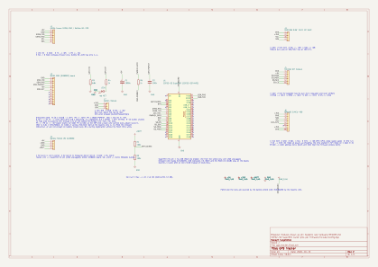
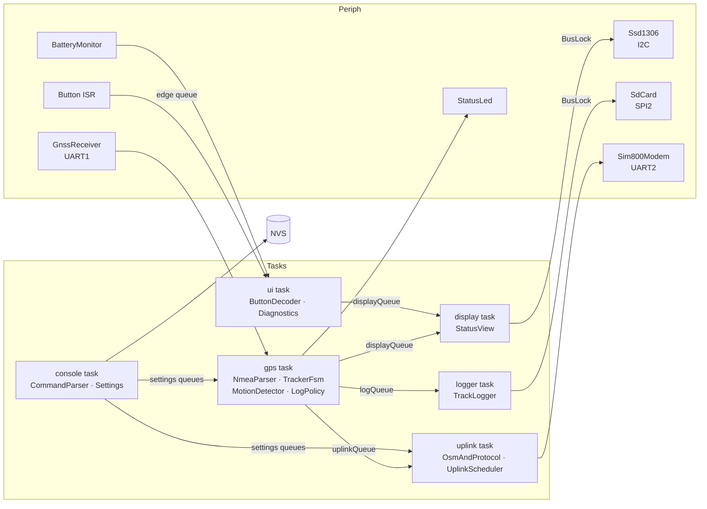
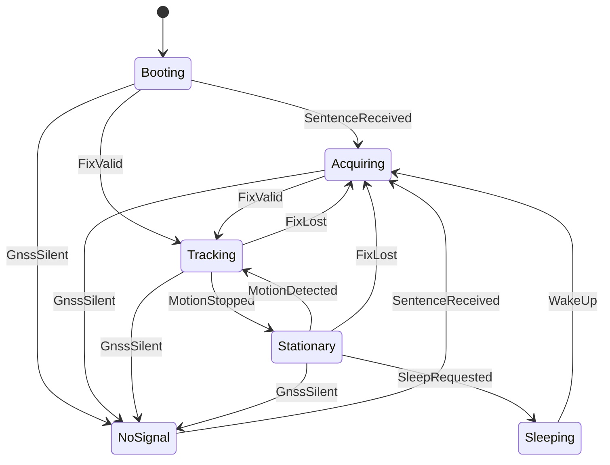
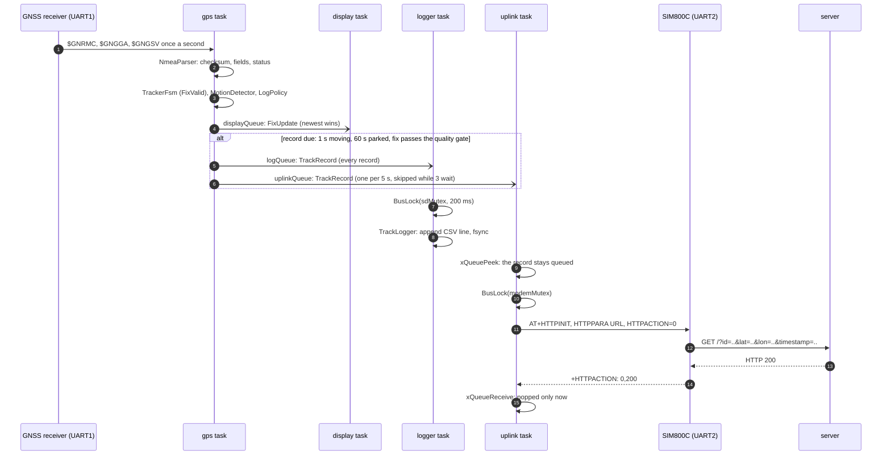

# GPS Tracker

> ESP32-S3 GPS tracker on ESP-IDF and FreeRTOS: reads NMEA from a GNSS
> receiver, shows the fix on an OLED, logs the track to a MicroSD card and
> uploads positions and a health report over GPRS to the project's own
> server (or any Traccar instance).

| Folder | What is in it |
| --- | --- |
| [firmware/](firmware/) | ESP-IDF / FreeRTOS firmware for the ESP32-S3 (PlatformIO project, host-side unit tests) |
| [web/](web/) | The tracker's own server and live map: Fastify + Postgres, React + Leaflet, deployed on Fly.io ([web/README.md](web/README.md)) |
| [hardware/](hardware/) | Components, power tree and GPIO map ([hardware/README.md](hardware/README.md)), KiCad schematic, wiring diagram and assembly sheet |
| [docs/](docs/) | Architecture description: layers, tasks, patterns, reliability |
| [tools/](tools/) | Generators for the schematic and the wiring diagram, run from the pin map |

Firmware and web app are released together from this repository; the
`firmware` and `web` GitHub Actions build and test each on every push, and
the web job deploys to Fly.io from `main`.

## About

A self-contained tracker for a vehicle, a bike or a backpack. It records
where it has been even without network coverage (the card is the source of
truth), reports live when it has coverage, and adapts how often it records
to whether it is actually moving. The firmware is written to be read: one
class per file, four layers with one-way dependencies, a table-driven state
machine, and every piece of pure logic unit-tested on the host.

| | |
| --- | --- |
| Controller | ESP32-S3 SuperMini (the build board); the same firmware also builds for the DevKitC-1 / WROOM-1 |
| GNSS | Foxeer M10Q-250 (u-blox M10) or Beitian BE-220, NMEA over UART; set to 1 Hz RMC/GGA/GSV at boot |
| Display | SSD1306 128×64 OLED, I2C |
| Storage | MicroSD over SPI (DMA), FAT, one CSV per UTC day |
| Uplink | SIM800C GPRS, HTTP GET: OsmAnd position report plus a health report once a minute |
| Power | 2×18650 through a Battery Shield V8, cell voltage on ADC; 1000 µF at the modem's supply pins |
| Motion | BMA400 accelerometer activity interrupt (hardware threshold, no fix needed); GNSS speed as fallback. Parked for `sleepAfterStationaryMs` (1 min in this build, for the demonstration; 10 min for service): deep sleep, wake on motion or the button. No coverage does not keep it awake: after `sleepUplinkGraceMs` (3 min) with points still queued it sleeps anyway, the card has them |

## Quick start

```bash
cd firmware
pio run -t upload -t monitor                # SuperMini (default env), flash and watch the logs
pio run -e devkitc -t upload -t monitor     # same firmware on the DevKitC-1
pio test -e native                          # 85 host-side unit tests for the pure logic
```

The web app runs with `cd web && pnpm install && pnpm dev` and a Postgres
from `pnpm db:up`; the device simulator in `web/tools/` feeds it without
hardware. Details in [web/README.md](web/README.md).

Serial console at 115200 baud (the same port as the log; the monitor echoes what you type). Type `help`:

```
help | show | diag | defaults | save | set <key> <value>
set moving_ms 2000        # record every 2 s while moving
set stationary_ms 120000  # every 2 min while parked
set url http://gps-tracker-mk.fly.dev   # the project server (default); Traccar: http://host:5055
set health_ms 30000       # health report every 30 s
set id my-bike
save                      # persists to NVS and applies live
```

## Wiring / schematic

Component roles, the power tree and the GPIO map for both boards are in
[hardware/README.md](hardware/README.md); the pin constants live in
[firmware/include/config.hpp](firmware/include/config.hpp). The KiCad schematic is
[hardware/kicad/gps_tracker.kicad_sch](hardware/kicad/gps_tracker.kicad_sch)
([PDF](hardware/kicad/gps_tracker.pdf)); it is generated from the same pin map
by `tools/gen_schematic.py` and passes ERC with no warnings.

Bench wiring (generated by `tools/gen_wiring_svg.py`; the interactive assembly sheet has the same drawing with per-module tables):





| Board | Build | Console |
| --- | --- | --- |
| ESP32-S3 SuperMini (build board, default) | `cd firmware && pio run -t upload -t monitor` | USB-C (USB Serial/JTAG) |
| ESP32-S3 DevKitC-1 / WROOM-1 | `cd firmware && pio run -e devkitc -t upload -t monitor` | connector labelled "UART" (CP2102) |

## Architecture

Four layers with one-way dependencies; the full rationale, the patterns
used and the reliability mechanisms are in
[docs/ARCHITECTURE.md](docs/ARCHITECTURE.md).



Tracker state machine (table in `firmware/include/logic/TrackerFsm.hpp`):



How a fix becomes a record on the card and a point on the map (the other
sequences, an upload failing and the sleep cycle, are in
[docs/ARCHITECTURE.md](docs/ARCHITECTURE.md)):



Status LED: white booting, red no signal, amber acquiring, green tracking,
blue parked.

### Feedback and regulation

- **LogPolicy** sets the record interval from measured movement: a short
  interval and a distance trigger while moving, a long heartbeat while
  parked. Thresholds and intervals are settings. It also refuses fixes
  with fewer than 5 satellites or HDOP above 3.0: shown on the screen,
  never recorded, so a window-side wander does not become a track.
- **UplinkScheduler** paces successful uploads and backs off exponentially
  on failures; after a run of unanswered requests the modem is
  power-cycled, while a request the server refuses only backs off.
- **SpeedMotionDetector** applies hysteresis and a stop delay to GNSS speed
  so receiver noise does not toggle the state.
- **EmaFilter** smooths speed and altitude for the display only; records
  carry raw values.
- **TimeZone** shifts the clock on the screen to local time (Kyiv, with
  the European summer-time rule); the card and the server keep UTC.

### Reliability

Task watchdog on every task (5 s, panic and reset, reason logged at boot;
the names of the tasks that missed the deadline are kept in RTC memory
across the panic, logged at the next boot and sent as `rst=taskwdt:<task>`);
SD commands capped at 1 s so a card that stops answering is a counted
error, not a watchdog reset;
NMEA checksum and field validation; receiver-silence timeout; bounded
retries then remount for the card; AT timeouts and modem power cycle;
RAII `BusLock` on shared buses with timeouts, never `portMAX_DELAY`;
queues that drop the oldest record instead of blocking the producer; NVS
settings range-checked with per-field fallback. Counters for every drop and
failure are logged once a minute (`diag` prints them on demand).

## Interfaces

| Interface | Peripheral | Notes |
| --- | --- | --- |
| UART1 | GNSS receiver | NMEA 0183 in; 115200 (Foxeer) or 9600 (BE-220), `set gnss` |
| UART2 | SIM800C | AT commands, 115200 fixed with `AT+IPR`; PWRKEY on a GPIO |
| I2C0 | SSD1306 (0x3C), BMA400 (0x14) | 100 kHz, one mutex; the BMA400 is only configured at boot |
| SPI2 | MicroSD adapter (5 V type) | sdspi host with DMA, FAT, 8.3 names |
| ADC1 | Battery divider | eFuse-calibrated, ×2 divider |
| GPIO | Button, BMA400 INT1 | interrupts → queues; RTC-capable for wake |
| RMT | WS2812 status LED | bytes encoder |

## Track log format

`/sdcard/TRACKS/YYYYMMDD.CSV`:

```
utc,lat,lon,alt_m,speed_kmh,course_deg,sats,hdop,batt_mv
2026-10-09T10:30:45Z,50.4520575,30.5257202,179.30,22.8,210.5,8,0.95,3900
```

Upload: two request types, both one plain-HTTP GET answered with 200.
The position report (OsmAnd protocol, so Traccar accepts it too) is
popped from the queue only after HTTP 200:

```
http://gps-tracker-mk.fly.dev/?id=<device>&lat=..&lon=..&timestamp=<unix>&speed=<kn>&bearing=..&altitude=<m>&hdop=..&batt=<%>
```

The health report goes out as soon as the bearer is up and then every
`health_ms` (60 s), fix or no fix: tracker state, reset reason, uptime,
sky view, every diagnostics counter, card and modem state, battery, heap
and stack headroom per task. It is what the server's dashboard shows as
module status; the full key list is in `web/README.md` on the
`tracker-web` branch, section "Device protocol":

```
http://gps-tracker-mk.fly.dev/?id=<device>&health=1&fw=..&up=..&rst=..&st=..&fix=..&sat=..&sky=..&sig=..&cn0=..&...&stk=gps/display/logger/uplink/ui
```

## Bring-up order

1. Board alone: flash, expect `Boot: reset reason power-on`, state `BOOT`
   on the LED, console `help` answers.
2. GNSS on GPIO5/4 (TX→GPIO5, RX→GPIO4): state goes `SEARCH` within seconds, `TRACK` with a sky
   view; `show` the fix on the log. Wrong baud shows as `rej` growing in
   `diag`. The top-right `u/s sat` is satellites used / satellites with a
   measured signal; the system page adds `sky` (almanac count above the
   horizon) and `cn0` (strongest signal, dB-Hz). `sky 11 sig 0 cn0 0` is
   an antenna with no signal; `sig 6 cn0 38` is a fix in the making.
3. OLED on GPIO8/9: tracking page appears. A NACK at boot is logged as
   `No display at address 0x3C` and the tracker runs without a screen; the
   display task re-initialises the controller after five failed frames.
4. MicroSD on GPIO10–13: `Mounted /sdcard` at boot, `SD ok` on the screen,
   a CSV on the card after the first record. The card also carries
   `TRACKS/EVENTS.LOG`, a mirror of the firmware's console log with date
   and time on every line (UTC, from the GNSS-set clock), so a run
   without a monitor still shows what preceded a reset and the boot line
   after it (`Boot: reset reason ...`). Every health report carries the
   reset reason (`rst=`), so the server keeps the restart history too.
5. SIM800C on UART2 and PWRKEY (through an NPN, Q1): `GPRS up on APN ...`, a health report within
   seconds (the device turns Online on the server), then `sent:` grows on
   the system page once there is a fix. Set `apn`, `url` and `id` first.

## Results

Bench, DevKitC-1 on the battery shield, 2026-10-11 (minute diagnostics
line and the web dashboard):

- Stack headroom after 30 min: gps 1400 B, display 2000 B, logger 3600 B,
  uplink 3000 B, ui 1400 B of 4096 / 4096 / 6144 / 7168 / 4096.
- GNSS at a window: 6-9 satellites above the horizon, 13-17 with a
  signal, strongest C/N0 28-34 dB-Hz; 1 Hz, 0 checksum failures per
  minute when the modem is idle, 1-3 per minute while it transmits.
- Uplink over 2G (Kyivstar, CSQ 14-20): one HTTP request takes 10-15 s;
  with a position every 5 s and a health report every minute the modem
  delivers 4-5 requests a minute, which is why the live queue is kept
  short (see "Known issues").
- Fault injection: `at AT+CFUN=1,1` (radio restart) 3/3 and
  `at AT+CPOWD=1` (modem power-down, firmware power-cycles it) 3/3 without
  a reset, after the modem got its own supply pair and the antenna was
  attached; the same firmware on the earlier wiring reset within 25 s of
  every registration.
- Charger pulled from the shield while running: card, display and modem
  all glitched in the same second; the card remounted itself, the
  display re-initialised, the modem answered after PWRKEY, and the chip
  then took a power-on reset from the rail dip. Charger plugged in: no
  reset.
- Battery alone, before the 1000 µF at the modem: a reset every 30 s
  during the first upload. With it: 648 s to the scheduled sleep, then
  three park / sleep / motion-wake cycles in a row (server rows with
  `rst=deepsleep`, fix back within seconds, records and uploads
  continuing), no resets.
- Deep sleep: the shield keeps its output up at the sleeping load; the
  BMA400's CS pin must be tied to 3.3 V, or it starts in SPI mode on
  about one power-up in three and cannot wake the tracker.
- First walk outdoors, 2026-10-13, two hours on battery (3.88-3.96 V):
  12 satellites in use, HDOP 0.8-1.0, a one-kilometre track on the map,
  one position on the server every 13 s; nine park / sleep / wake cycles,
  no power resets. Nine task-watchdog resets, all while walking and
  shortly after a boot, none at the bench: the card was the suspect
  (ESP-IDF waits 5 s, the watchdog period, for a write to finish), which
  is why the watchdog now records the task it caught and card commands
  are capped at 1 s. Interrupted uploads left the modem's HTTP stack
  busy; three failures later the uplink power-cycled it, as designed.

- CPU load (`diag`, FreeRTOS run-time statistics, both cores): the idle
  tasks hold 98-99 % of the time; the whole application, six tasks, takes
  1-2 %. The logger is the busiest task (card writes), then the display
  (I2C frames), then gps.
- Button: after the contact-bounce fix (a level is accepted only once it
  has held for 50 ms) every short press switches the page; the bench
  switch produces up to 16 edges per press. The bench button is a 3-pin
  module with its own pull-down, so the line idles low: read as a bare
  switch to GND it looked "pressed" at rest, and every deep sleep ended
  0.4 s after it began as a button wake. `Config::buttonPressedHigh`
  now names the wiring, and a line that reads pressed at rest is left
  out of the wake sources.
- Resets during the modem's network attach, 2026-10-14: the DevKitC
  took a task-watchdog reset about 17 s after "Modem answered", on every
  attach. Isolated step by step: the 5 V feed (own USB source), the
  3.3 V rail (brownout detector raised to 2.98 V, never tripped), the
  signal wires and finally the ground were all removed, and the DevKitC
  still reset with nothing but the modem's radio a hand's width away.
  The SuperMini ignores the radio even with the antenna beside it, but
  reset the same way through the PWRKEY wire, which runs from beside the
  modem's power circuit into an ESP32 pad. 1 kΩ in series and 100 nF to
  GND at the ESP end fixed it: a fresh attach, six minutes of uploads
  and a park / sleep / motion-wake cycle on one shield, no reset. The
  final design drives PWRKEY through an NPN transistor instead, so the
  modem's line no longer touches the ESP pin at all; verified with a
  fresh attach.
- Field test on the SuperMini, 2026-10-17: a ride through Chernivtsi,
  2 h 43 min, about 16 km, up to 47 km/h. 23 park / sleep / motion-wake
  cycles, no unplanned reset. 3 245 records on the card without an
  error, 378 positions on the server, none lost. 103 931 NMEA sentences,
  231 rejected on the checksum (0.2 %). 12 satellites in use, median
  HDOP 0.59; free heap never below 275 kB.
- After every wake in that ride the modem took two PWRKEY presses and
  GPRS came back 32-84 s later (median 37 s): the 6 s probe gave up on a
  modem that had only been parked, and the first press switched it off.
  After a deep-sleep wake the firmware now probes a running modem for up
  to 10 s before any press, and an attach refused while the modem is
  still attaching on its own is retried. On the bench: answer in 2.2 s,
  no presses, GPRS up 27-28 s after the wake, no failed connect.
- Receiver date after a cold start: one fix came with a valid position
  and the date 2087-07-15, which set the clock until the next boot. A
  fix dated outside 2025-2045 is now treated as no fix yet.

_Still to measure: current draw (tracking / uploading / asleep) and a
multi-hour soak on battery._

## Known issues and limitations

- Deep sleep keeps every module powered and puts each into its own
  low-power state, so the standby current is set by the battery shield's
  converter (a few mA), not by the ESP32's microamps. Some 18650 shields
  switch their output off below a few tens of mA; check yours before
  relying on sleep (see hardware/README.md).
- SIM800C is 2G only.
- The DevKitC-1 build is sensitive to the modem's radio on the bench
  (see Results); keep the modem well away from it, or use the
  SuperMini.
- FAT without long file names: track files use 8.3 names.
- The uplink gets one record per `uplink_min_ms` while the card gets
  every one, and while the link is up its queue is kept to a few records
  so the map always shows the latest position even when a 2G request
  takes longer than the interval. While the link is down the queue of 64
  buffers the outage, after which the oldest records are dropped
  (counted, and shown on the dashboard); the card keeps them all.

## What I would improve next

- Operator menu on the screen: a table of known APNs (Kyivstar, Vodafone UA,
  lifecell) selected with the button and saved to NVS, so a SIM swap needs no
  console. The uplink task already re-opens the bearer on an APN change.
- Measured currents awake, tracking, uploading and asleep.
- Batch uploads (one request, many points) now that the server is ours;
  the modem's socket commands make one TCP session per batch possible.
- GPX export alongside CSV.
- UBX configuration of the receiver (rate, constellations) instead of the
  module defaults.

## Documentation

- [hardware/README.md](hardware/README.md) — components, power tree, GPIO map
- [docs/ARCHITECTURE.md](docs/ARCHITECTURE.md) — layers, tasks, patterns, reliability
- `hardware/kicad/` — KiCad schematic, PDF and SVG (generated by `tools/gen_schematic.py`); `hardware/wiring.svg` and `hardware/assembly-sheet.html` from `tools/gen_wiring_svg.py`
- [firmware/README.md](firmware/README.md) — build, flash, test; where each class lives
- [web/README.md](web/README.md) — run the server and the map locally, sign-in, deployment
- [CHANGELOG.md](CHANGELOG.md) — releases

## Author

Maksym Kutyshenko
