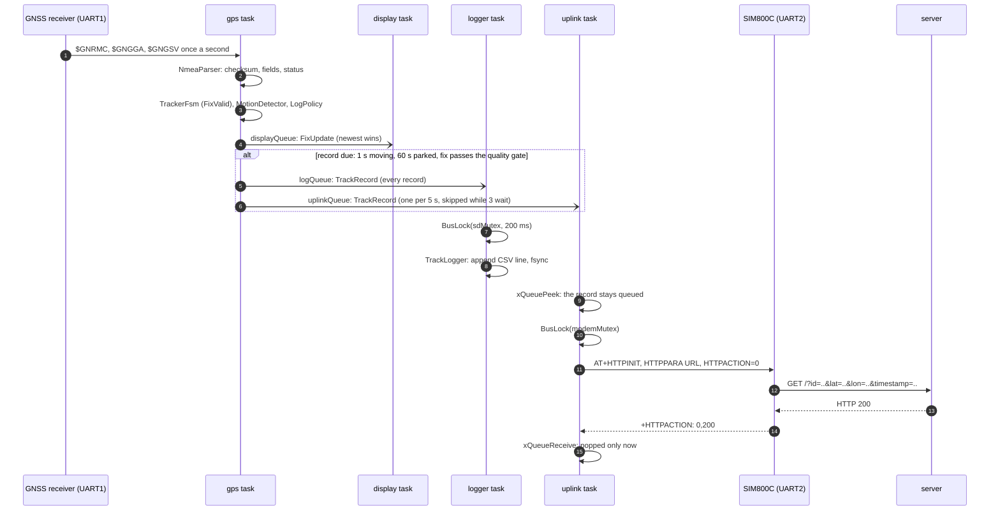
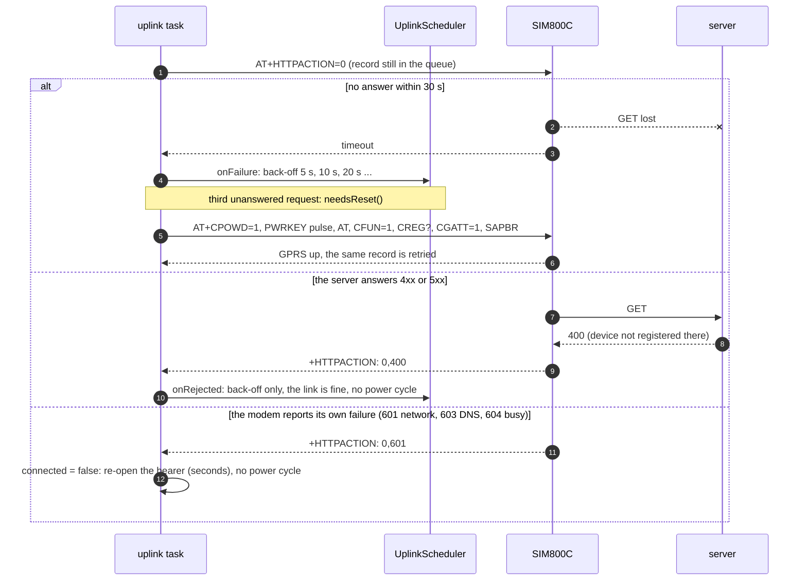

# Software architecture

Design rules and the class layout for the GPS tracker firmware. The code
rules: fixed-width types, `ESP_LOGx` only, every `esp_err_t` checked, `App`
owns the tasks, peripherals stay passive. The three goals: **readable,
extendable, reliable**, written in OOP style with design patterns where
they earn their place.

## 1. Layers

Four layers with one-way dependencies, and what lives in each:

| Layer | Responsibility | Classes |
| --- | --- | --- |
| Periph | Talk to hardware, nothing else | `UartPort`, `GnssReceiver` + `GnssProfile`, `I2cBus`, `Ssd1306`, `SdCard`, `Sim800Modem` + `AtCommand`, `BatteryMonitor`, `Button`, `StatusLed`, `Bma400` |
| Logic | Pure decisions, no ESP-IDF includes, host-tested | `Fix`, `NmeaLineAssembler`, `NmeaParser`, `DecimalParser`, `TrackerFsm`, `IMotionDetector` (`AccelMotionDetector`, `SpeedMotionDetector`, `NullMotionDetector`), `EmaFilter`, `Geodesy`, `LogPolicy`, `TrackRecord`, `ButtonDecoder` |
| Transport / Output | Move data out of the device | `IStorage` → `SdStorage`, `TrackLogger`; `IUplinkTransport` → `ModemTransport` / `NullUplinkTransport`, `OsmAndProtocol`, `HealthReport`, `UplinkScheduler`; `StatusView`, `DisplayMessage` |
| Reliability | Keep the system alive and honest | `WatchdogSubscription`, `BusLock` (RAII mutex guard), `Settings` (NVS), `Diagnostics`, `EventLog` (console log mirrored to the card); the reset reason is logged at boot and carried in every health report |

Dependencies point downward only: Logic never includes a Periph header.
Transport classes depend on Logic types (`Fix`, `TrackRecord`) and on
Periph *interfaces*, not concrete drivers.

## 2. Tasks and queues

```
UART1 ──► gps_rx ──► NmeaParser ──► TrackerFsm ──┬─► latestFix   (1 slot, xQueueOverwrite) ──► display ──► StatusView ──► Ssd1306 (I2C, BusLock)
                                                 ├─► logQueue    (N slots, every fix)       ──► logger  ──► TrackLogger ──► SdCard (SPI, BusLock)
                                                 └─► uplinkQueue (N slots, batched)         ──► uplink  ──► Uplink ──► Sim800Modem (UART2)
GPIO ISR (button, BMA400 INT1) ──► uiEvents (ISR-safe queue) ──► ui ──► TrackerFsm events / Settings / LogPolicy
Watchdog: every task subscribes and feeds it once per loop iteration; the ISR hook keeps the culprits' names in RTC memory for the next boot.
```

- One task per independent activity, each entered through a static
  trampoline, each owning exactly one peripheral that may block.
- Tasks exchange **values** (`Fix`, `UiEvent`), never pointers to shared
  objects.
- The FSM runs in the `gps_rx` task; other tasks only receive its outputs.
  State is published, not shared.
- Buses used by more than one task (I2C: display + accelerometer; SPI: SD
  only, but remount vs write) are guarded by one mutex each, always taken
  through `BusLock` so it cannot be forgotten on an error path.

### Sequences

**A fix becomes a record and a point on the map.** The record is popped
from the uplink queue only after the server has acknowledged it; the card
gets every record, the modem one per interval.



**An upload fails.** Three outcomes, three different answers: a request
nobody answered counts towards a modem power cycle, a server rejection
only backs off, and a modem-side error re-opens the bearer.



**Park, sleep, wake.** Everything happens in the gps task, which owns the
FSM; the other tasks are stopped first so no one is mid-transaction on a
bus that is about to be switched off.

```mermaid
sequenceDiagram
    autonumber
    participant A as BMA400 INT1
    participant G as gps task
    participant T as other tasks
    participant M as SIM800C
    participant R as GNSS receiver
    participant P as OLED, SD card
    G->>G: FSM in Stationary; SleepPolicy counts sleepAfterStationaryMs
    G->>G: due: uplink queue empty, or the grace period for it is over
    G->>T: take the I2C and SD mutexes (1 s slices, watchdog fed); suspend display, logger, ui, console
    G->>P: display off
    G->>T: take the modem mutex (60 s if an upload is in flight, 10 s if never connected); suspend uplink
    G->>M: health report with state=sleeping (HTTP GET)
    G->>M: AT+CFUN=0 (minimum functionality, ~2 mA)
    G->>R: UBX-RXM-PMREQ: backup mode, orbits kept
    G->>P: EVENTS.LOG flushed; card unmounted
    G->>G: arm wake: INT1 high (EXT1), button (EXT0) unless its line reads as pressed, timer 1 h; RTC domain stays on
    G->>G: esp_deep_sleep_start()
    A-->>G: activity pulse: the chip boots from scratch
    G->>G: Boot: reset reason deep-sleep wake (motion); clock kept; fix back in seconds
```

## 3. Patterns, and why each one

| Pattern | Where | Why it is worth it here |
| --- | --- | --- |
| **Interface (abstract class)** | `IFixSink`, `IFixSource`, `IStorage`, `IUplinkTransport`, `ITimeSource` | Logic and Transport are written against interfaces, so the host tests inject fakes (a canned NMEA stream, an in-memory storage) and the hardware driver can be swapped without touching callers |
| **Strategy** | `GnssProfile` (Foxeer vs BE-220: baud, init sentences), `UplinkProtocol` (Traccar/OsmAnd vs custom endpoint), `LogPolicy` (fixed interval vs motion-adaptive) | Each is a choice made once at start-up from `Settings`; a strategy object keeps the `if (module == …)` out of the data path |
| **State (table-driven FSM)** | `TrackerFsm`: `NoFix → Acquiring → Tracking → Idle(no motion) → Sleep`, plus `StorageError`, `UplinkError` overlays | An explicit transition table can be drawn and read in one screen; it is unit-tested by feeding events and asserting states |
| **Observer via queues** | `FixBus` fans one `Fix` out to the display, logger and uplink queues | FreeRTOS queues are the observer mechanism that is safe across tasks; no callback registration, no shared state |
| **RAII guard** | `BusLock`, `WatchdogSubscription`, `SdMount` | A guard releases in its destructor, so every early-return and error path releases the mutex / unmounts the card. This is the single biggest reliability win in the code base |
| **Command** | `AtCommand` (`"AT+CSQ"`, expected response, timeout, parser) executed by `Sim800Modem` | Each modem interaction is a value object with its own timeout and parser; sequences (power-on, attach GPRS, HTTP POST) become lists of commands instead of nested ifs |
| **Composition root / Factory** | `App` constructs every object once, wires strategies from `Settings`, starts tasks | One place to read to understand the whole system; nothing is global, nothing is a singleton |
| **Null Object** | `NullAccelerometer`, `NullUplink` | The BMA400 is not delivered yet and GPRS may be absent on the bench; a null implementation keeps the callers free of `if (accel != nullptr)` |
| **Builder-style value construction** | `TrackRecord::from(fix, battery)` | Records assembled in one named place, so the CSV/GPX formatter and the uplink payload cannot drift apart |

Patterns deliberately **not** used: Singleton (hides dependencies),
dynamic polymorphism inside the sample loop where a template would do
(`EmaFilter<T>` is a template), exceptions and RTTI (ESP-IDF default), heap
allocation after `App::run()` (fixed buffers sized in `Config`).

## 4. Reliability mechanisms

| Threat | Mechanism |
| --- | --- |
| Task hangs | Task WDT, 5 s, every task subscribed; panic + reset; reset reason logged at boot |
| Bad NMEA | Checksum, length cap, field count, fix-valid flag; a bad sentence is counted and dropped, never parsed into a `Fix` |
| GNSS silent | `gpsSilenceTimeoutMs` → FSM to `NoFix`, display shows it, receiver re-initialised |
| SD removed / write fails | `IStorage` returns `esp_err_t`; `TrackLogger` retries ×3, then remounts through `SdMount`; records stay queued up to the queue depth, then the oldest are dropped and counted |
| Modem stuck | Every `AtCommand` has a timeout; three failures → PWRKEY power cycle; exponential back-off on GPRS attach |
| I2C NACK | Bounded retry, then bus reset; display keeps its last frame |
| Mutex held across error | `BusLock` RAII |
| Queue full | Single-slot queues overwrite (latest value wins); deep queues drop oldest and count, never block the producer |
| Bad settings in NVS | `Settings::load()` validates ranges and falls back to `Config` defaults per field |
| Deep sleep state loss | `TrackerFsm` persists what matters (odometer, last fix) in NVS before sleep; wake source decides the initial state |

Every dropped/failed event increments a counter in `Diagnostics`, logged
once a minute together with stack high-water marks and CPU load. Those
numbers go in the README.

## 5. Extendability hooks

- New GNSS module: add a `GnssProfile`.
- New upload backend: implement `IUplinkTransport` / `UplinkProtocol`.
- New storage (LittleFS instead of SD): implement `IStorage`.
- New sensor on I2C: a Periph class taking `I2cBus&`, read inside an
  existing task or a new one; add its data to `TrackRecord`.
- New display page: a `StatusView` page object; the `ui` task cycles pages.

## 6. Testability

Everything in the Logic layer is header-only or has no ESP-IDF includes and
runs under `pio test -e native` (Unity). Transport classes are tested with
fakes behind the interfaces (`FakeStorage`, `FakeFixSource`). Periph
classes are verified on hardware with their own `begin()` self-checks (chip
ID reads, a test frame, a `AT` round-trip).

## 7. The BMA400 motion source, and deep sleep (next)

The accelerometer fits the three places that were reserved for it.

1. **Driver** — `periph/Bma400.hpp/.cpp`, a class taking `I2cBus &` like
   `Ssd1306`. `begin()` probes 0x14 and 0x15 for the chip id (0x90),
   soft-resets, and configures generic interrupt 1 for *activity*: a
   change between consecutive samples above `Config::accelActivityThresholdMg`
   on any axis, sustained for `accelActivityDurationSamples` at 100 Hz,
   pulsed on INT1 (GPIO6, push-pull, not latched). The ISR only counts
   pulses in an atomic; there is no I2C traffic after `begin()`, so the
   bus is the display's alone at run time. A silent chip is logged and the
   tracker falls back to GNSS speed.
2. **Motion source** — `AccelMotionDetector` in `logic/MotionDetector.hpp`
   implements `IMotionDetector` from an `IActivitySource` (the driver on
   the target, a fake in the host tests): moving on the first pulse,
   stopped after `motion_stop_delay_ms` without one. `App::begin` points
   `motion_` at it when the chip answered. The FSM, `LogPolicy` and the
   display are untouched, and the diagnostics line names the source in
   use (`motion bma400 pulses N`).
3. **Sleep** — `SleepPolicy` (logic, host-tested) says when: parked
   (`Stationary`) for `Config::Defaults::sleepAfterStationaryMs` with
   nothing left in the uplink queue, or with the queue still stuck once
   `sleepUplinkGraceMs` more have passed (no coverage must not keep the
   tracker awake; the card has every point, the health report shows the
   backlog left behind); 0 disables it. The gps task, which
   owns the FSM, then runs `App::enterSleep`: `SleepRequested` to the FSM
   (LED off), a last health report with state `sleeping` so the dashboard
   knows it was deliberate, modem to minimum functionality (`AT+CFUN=0`,
   ~2 mA, no cold-boot burst on wake), GNSS to software backup mode
   (orbit data kept, wakes on the first UART byte), display off, event log
   flushed and the card unmounted, then EXT1 wake on INT1 (activity, high), EXT0 wake on the button (low),
   a timer wake every hour for a sign of life, the RTC peripheral domain
   kept on so the internal pulls hold during sleep, and `esp_deep_sleep_start()`.
   Nothing returns: the next boot logs `Woke from deep sleep: motion` or
   `button` and initialises everything from the top. The modules keep
   their supply; the floor is the battery shield's own converter at a few
   mA. Measured currents belong in the README results.

## 8. Reading order for a reviewer

All paths under `firmware/`.

1. `include/config.hpp` — pins and tuning.
2. `src/App.cpp` — composition root, task layout.
3. `include/logic/TrackerFsm.hpp` — states and transitions.
4. `include/logic/NmeaParser.hpp` — input validation.
5. `test/test_native/` — the behaviour pinned by tests.

## Health report (device → web app)

Positions alone say nothing while there is no fix, and nothing about the
card, the modem or the memory. The uplink task therefore sends a second
request type, `HealthReport::buildUrl`, every `Settings::healthIntervalMs`
(60 s): the `Diagnostics` counters, the receiver's sky view, card and modem
state, battery, heap and stack headroom, reset reason and uptime, in the
same one-GET-per-report shape as the OsmAnd position so the SIM800C's HTTP
stack and the scheduler's back-off serve both. The first one goes out as
soon as the bearer is up, before any fix.

The snapshot is assembled by the ui task (`App::publishHealth`, every
`Config::healthPublishPeriodMs`) into a single-slot `healthQueue_` that the
uplink task peeks: the same overwrite-queue pattern as the battery reading,
so no task reads another task's objects. The two fields only the modem's
owner can know (signal quality, upload backlog) are patched in by the uplink
task before the URL is built. The web app in `web/` turns consecutive
reports into per-module verdicts (`web/server/src/status.ts`); a Traccar
server simply keeps the keys as attributes.
